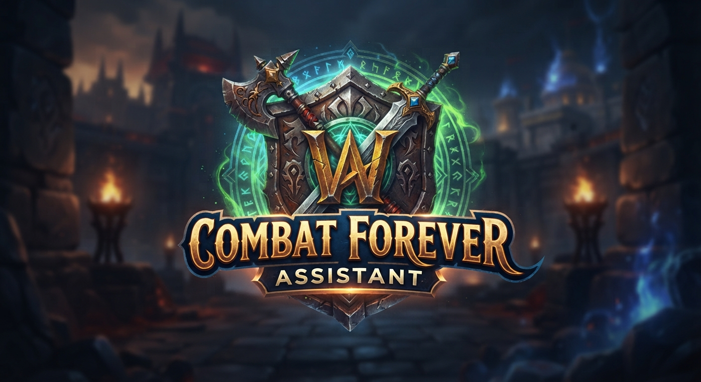

# Combat Forever Assistant

  

> **[English](#english)** · **[Português (ptBR)](#português-ptbr)**

---

## English

Rotation assistant for **WoW Forever** (Interface `16001`, vanilla content on a modern
engine). When a class module suggests an ability, the addon highlights the
action-bar button that ability is bound to — with colors per function (damage, AoE,
interrupt, defensive, utility) or a single user-chosen color.

It does **not** press the key for you — it only highlights the button. You stay in
control.

### Status — early development, **not playable yet**

| Area | State |
|---|---|
| Addon loads, `/cfa` menu (General / Key button / About) | Working (tested in game) |
| Menu settings persist — fixes the orphan-table bug where changes were written to a table detached from the SV global | Corrected (user-authored fix) — not yet verified in game |
| Highlight: **circle** or **border** modes | Working (tested in game) |
| Border width slider (0–60 px), single-color option, per-function colors | Working (tested in game) |
| Key button (draggable widget showing the bound key, lock option, "always show", 6 fonts, size, background/text color, transparency, reset) | Working (tested in game) |
| **Buff library** (`CFA.BuffLib`) — all 9 vanilla classes, all ranks, aura/cast IDs, tier tracking, "outdated buff" flags | Implemented, data verified via wowhead classic/classicdb/wiki — **not yet verified in game** |
| **Hunter class module (SV / BM / MM)** — declarative rotation (nodes: Serpent Sting, Aimed/Arcane Shot, Wing Clip, traps, aspects…), spec detection via C_Traits + override, Castable engine + aura beliefs | Implemented (not yet verified in game) — load validated; runtime test pending |
| **Rotation editor window** (per-character node toggles, per-node conditions/filters via 6 cascade axes + special predicates, icon-click flash test, BM/MM/SV tabs, reset-to-default) | Implemented (not yet verified in game) |
| Login welcome (class / spec + detection source / race greeting) | Implemented (not yet verified in game) |
| Class modules (Shaman, Warrior, Druid, Paladin) | **Not implemented yet** — next phases |

> **Saved variables:** settings persist on `/reload` (and on logout/clean exit), like any
> Blizzard client. An earlier bug made menu changes persist nowhere: `addon.db` was bound
> to a table created at load time instead of the global the client writes to. Fixed by
> re-anchoring `addon.db` / `addon.charDb` to the real globals inside `ADDON_LOADED` (see
> `memory/enciclopedia/12-savedvariables-e-persistencia.md` in the project archive).

### Hunter rotation

`/cfa` → **Hunter** tab (visible only to Hunters):
- toggle the module on/off, pick the spec (**auto / BM / MM / SV**)
- click **Open rotation editor** to open the rotation window (cards with every
  skill of the rotation — click to enable/disable individual nodes, per character)
- each card: **[+]** adds conditions under which the ability fires (6 cascade
  filter axes — combat / environment / target / range / resource / area — plus
  special predicates), **[-]** removes them, per character
- clicking a node's **icon flashes the button** it is bound to on your action bars (test)
- rotations are declared as data (`Modules\Hunter\Scripts_SV|BM|MM.lua`) and the
  per-character overrides are stored in the character DB
  (`CombatForeverAssistantCharDB.hunterRotation`)

> Engine: declarative rotation runner in `Core.lua` (`ConcatCommonNodes` /
> `RunDeclaredRotation`), spec detection via `C_Traits` (override respected first),
> rank resolution via the spell book, aura beliefs for secret auras in combat, and
> press-suppression so the highlight dies the instant you press the key.

### Highlight modes

- **Circle** — a dashed colored ring around the recommended button (native textures).
- **Border** — a colored frame around the button (4 edge bars, 0–60 px wide).

### Installation

Copy the `CombatForeverAssistant` folder into `Interface\AddOns\` and type `/cfa`.

### Requirements

WoW Forever, Interface **16001**. No external dependencies.

### License

[MIT](LICENSE) — © 2026 Marcus. See `LICENSE`.

---

## Português (ptBR)

Assistente de rotação para o **WoW Forever** (Interface `16001`, conteúdo vanilla em
engine moderna). Quando um módulo de classe sugere uma habilidade, o addon destaca o
botão da barra de ação onde a habilidade está ligada — com cores por função (dano, área,
interrupção, defensivo, utilidade) ou uma cor única escolhida por você.

Ele **não** aperta a tecla por você — apenas destaca o botão. Você continua no controle.

### Status — desenvolvimento inicial, **ainda não jogável**

| Área | Estado |
|---|---|
| Addon carrega, menu `/cfa` (Geral / Botão de tecla / Sobre) | Funcionando (testado em jogo) |
| Configurações do menu persistem — corrige o bug da tabela órfã (mudanças iam para uma tabela desconectada do global de SV) | Corrigido (correção do usuário) — ainda não verificado em jogo |
| Destaque: **círculo** ou **moldura** | Funcionando (testado em jogo) |
| Slider de largura da moldura (0–60 px), cor única, cores por função | Funcionando (testado em jogo) |
| Botão de tecla (widget arrastável mostrando a tecla, trava, "sempre exibir", 6 fontes, tamanho, cor de fundo/texto, transparência, restaurar padrões) | Funcionando (testado em jogo) |
| **Biblioteca de buffs** (`CFA.BuffLib`) — as 9 classes vanilla, todos os ranks, IDs de aura/cast, tiers, aviso de buff desatualizado | Implementada, dados verificados via wowhead classic/classicdb/wiki — **ainda não verificada em jogo** |
| **Módulo Hunter (SV / BM / MM)** — rotação declarativa (Serpent Sting, Aimed/Arcane Shot, Wing Clip, armadilhas, aspectos…), detecção de spec via C_Traits + override, engine de Castable + crenças de aura | Implementado (ainda não verificado em jogo) — load validado; teste em jogo pendente |
| **Janela de edição de rotação** (liga/desliga nós por personagem, condições/filtros por nó via 6 eixos de filtro + predicados especiais, clique no ícone para testar o flash, abas BM/MM/SV, restaurar padrão) | Implementada (ainda não verificada em jogo) |
| Boas-vindas no login (classe / spec + origem da detecção / saudação racial) | Implementada (ainda não verificada em jogo) |
| Módulos de classe (Shaman, Warrior, Druid, Paladin) | **Ainda não implementados** — próximas fases |

> **Variáveis salvas:** as configurações persistem no `/reload` (e no logout/saída limpa),
> como em qualquer cliente Blizzard. Um bug anterior fazia as mudanças sumirem: `addon.db`
> ficava ligado a uma tabela criada ao carregar o arquivo, não ao global que o client
> grava. Corrigido re-ancorando `addon.db` / `addon.charDb` aos globals reais dentro do
> `ADDON_LOADED` (veja `memory/enciclopedia/12-savedvariables-e-persistencia.md` no
> arquivo do projeto).

### Rotação do Hunter

`/cfa` → aba **Hunter** (visível só para caçadores):
- ligar/desligar o módulo e escolher a spec (**automático / BM / MM / SV**)
- clique em **Abrir editor de rotação** para abrir a janela com os cards de
  todas as habilidades da rotação — clique para ligar/desligar cada nó, por personagem
- cada card: **[+]** adiciona condições para a habilidade disparar (6 eixos de
  filtro em cascata — combate / ambiente / alvo / alcance / recurso / área — além
  dos predicados especiais), **[-]** remove, por personagem
- clicar no **ícone** do nó faz o botão ligado a ele piscar nas suas barras (teste)
- as rotações são declaradas como dados (`Modules\Hunter\Scripts_SV|BM|MM.lua`) e os
  overrides por personagem ficam no DB do personagem
  (`CombatForeverAssistantCharDB.hunterRotation`)

> Motor: runner de rotação declarativa no `Core.lua` (`ConcatCommonNodes` /
> `RunDeclaredRotation`), detecção de spec via `C_Traits` (override tem prioridade),
> resolução de rank pelo spell book, crenças de aura para as auras secretas em combate
> e supressão do brilho assim que você aperta a tecla.

### Modos de destaque

- **Círculo** — anel segmentado colorido em volta do botão (texturas nativas).
- **Moldura** — moldura colorida em volta do botão (4 barras, 0–60 px de largura).

### Instalação

Copie a pasta `CombatForeverAssistant` para `Interface\AddOns\` e digite `/cfa`.

### Requisitos

WoW Forever, Interface **16001**. Sem dependências externas.

### Licença

[MIT](LICENSE) — © 2026 Marcus. Veja `LICENSE`.
